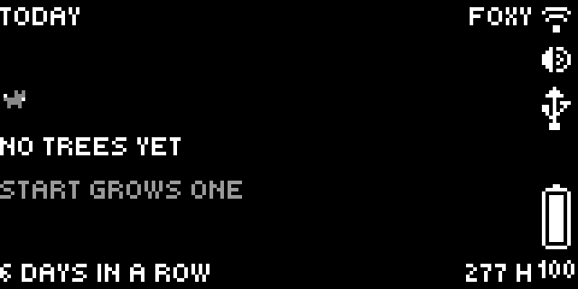
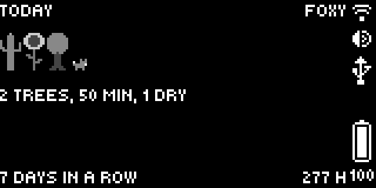
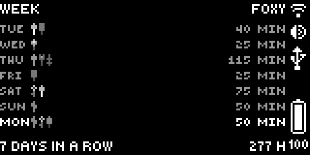
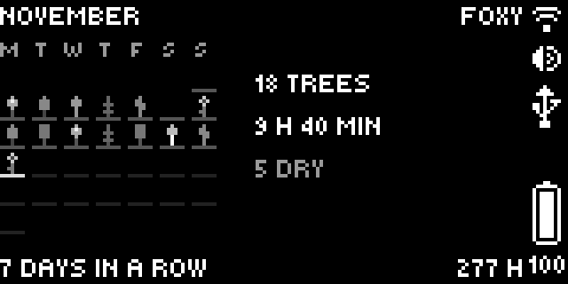
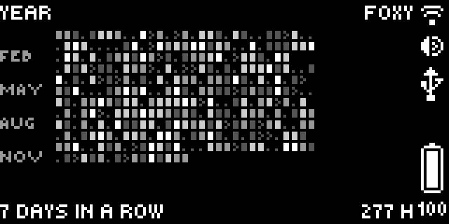

# Focus Forest

Focus sessions grow trees, and a pet roams your forest.


Each focus session grows a tree on the front display. Pick a length with the wheel and press Start: the tree grows while the time counts down. Finish the session and the tree joins the row of your last days; give it up and the tree dries out. Between sessions a fox walks along the row, and the back display shows your forest for today, the week, the month and the year.

A JavaScript app for [BUSY Bar](https://busy.app).

## What the bar shows

Between sessions the front display shows the session length on top and a row of the last 18 days under it, today on the right. Each day has the tree of its last finished session, a dry tree when all its sessions were given up, or an empty slot when it had none. The fox walks along the row and stops with its head down next to each dry tree.

Turning the wheel picks the session length: 15, 25, 50 or 90 minutes.


Between sessions the back display has four pages, and OK turns them. Each page has its title and the fox's name on top, and at the bottom the days in a row with a finished session and the hours of focus in all. The first page is today: before the first tree of the day it says NO TREES YET.



Start begins a session. On the left a tree grows from a sprout to its full height, and on the right the time left counts down. The tree is a random species among the ones you have unlocked: the spruce from the start, the birch at 4 hours of focus in all, the oak at 10, the sakura at 25, the maple at 50, the palm at 75, the cactus at 100 and the sunflower at 150. In December a snowy fir joins them.


During a session the back display says BUSY and the minutes left, for the people around you.


When the time runs out the tree takes the slot of the day the session began, a short sound plays if Sound is on, and the fox jumps for joy.


Back during a session gives it up, and its tree dies. A day with only dead trees gets a dry tree in the row, and the fox stops by it with its head down. A session left another way, by the mode switch or a long press of Back, counts as given up at the next launch of the app.


The today page shows the day's trees large with the fox beside them, and how many trees grew, their minutes, and how many dried out.



The week page has the last 7 days, today at the bottom: the day of the week, its trees, small, and its minutes.



The month page is a calendar of the month from Monday, with the tree of each day so far, and beside it the trees grown this month, their hours and minutes, and the dry ones.



The year page has the last 12 months, a row each, this month at the bottom. A day with grown trees is lit brighter the more minutes of focus it had; a day with only dry trees is dotted, and a day without a session is a single dot.



## Buttons

| Button | What it does |
| --- | --- |
| Wheel | Changes the session length, between sessions. |
| Start | Starts a session. |
| OK | Turns the page of the back display: today, week, month, year. Not during a session. |
| Back | During a session, gives it up and the tree dies. Between sessions, quits the app. |

## Settings

| Setting | What it does |
| --- | --- |
| Session length | The length the app starts with: 15, 25, 50 or 90 minutes, 25 by default. The wheel changes it until the app is closed. |
| Sound | The sound when a tree has grown. On by default. |
| Pet's name | The fox's name on the back display, Latin letters, up to 10. FOXY by default. |

The app reads its settings when it starts.

## Data

None from the network: the app works offline. It keeps the forest on the BUSY Bar, in its local storage: the trees and minutes of each day back to the first of the month 11 months ago, the minutes of focus of the days before that, and the session under way.

## Build

Node 24 and npm:

```sh
npm ci
npm run build         # dist/io.github.vvzvlad.forest.tgz
npm run app:install   # install it on a BUSY Bar connected over USB
npm run app:run       # start it
```

## License

[MIT](LICENSE)
